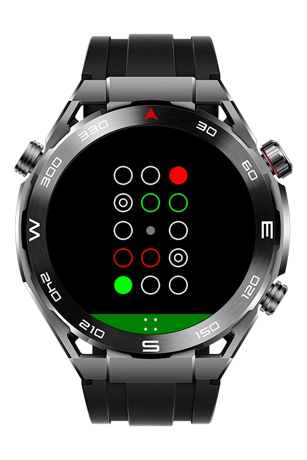
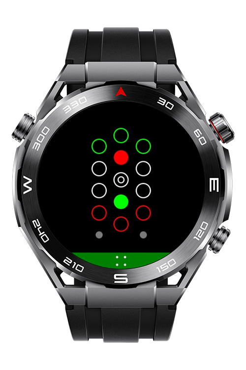
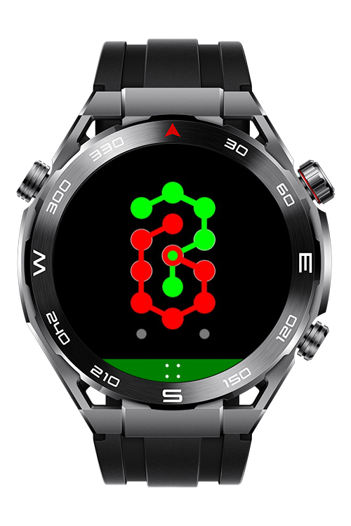
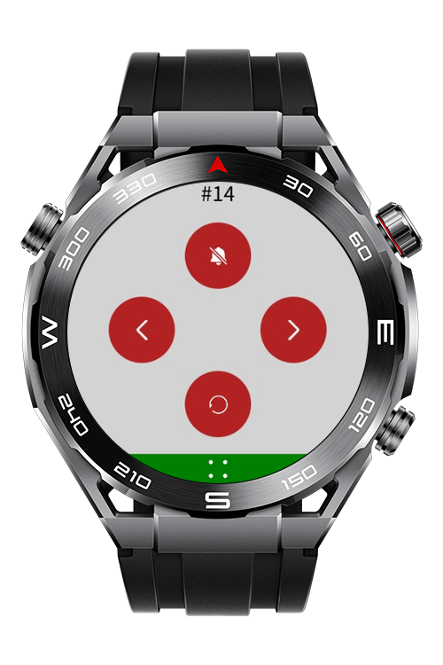

> **Note:** To access all shared projects, get information about environment setup, and view other guides, please visit [Explore-In-HMOS-Wearable Index](https://github.com/Explore-In-HMOS-Wearable/hmos-index).

# Lynk Puzzle Game

A mind puzzle game where the main goal is to connect all dots to each other.

# Preview

<div>
  
  
  
  
</div>

# Use Cases

- **Game Play:** Connect all dots to each other to pass the level.
- **Navigate:** Go previous and next levels.
- **Restart:** Restart current level.
- **Toggle Vibration:** Open and close vibration.

# Tech Stack

Languages: CSS, HML, JS
Frameworks: 4.0.0(10)
Tools: DevEco Studio Version 6.0.1.251
Libraries: @system.device, @system.file, @system.storage, @system.vibrator

# Directory Structure

```
entry/src/main/js/MainAbility
│   app.js
├───common
│   ├───img
│   │       left.png
│   │       menu.png
│   │       restart.png
│   │       right.png
│   │       vibrate_off.png
│   │       vibrate_on.png
│   └───js
│           Cell.js
│           DeviceUtils.js
│           FileUtils.js
│           Game.js
│           keyStorage.js
│           Levels.js
│           VibratorUtils.js
└───pages
    └───index
            index.css
            index.hml
            index.js
```

# Constraints and Restrictions

## Supported Devices

- Huawei Sport (Lite) Watch GT 4/5/6
- Huawei Sport (Lite) GT4/5 Pro
- Huawei Sport (Lite) Fit 3/4
- Huawei Sport (Lite) D2
- Huawei Sport (Lite) Ultimate

# LICENSE

**Lynk Puzzle Game** is distributed under the terms of the **MIT License**.
See the [LICENSE](/LICENSE) for more information.
